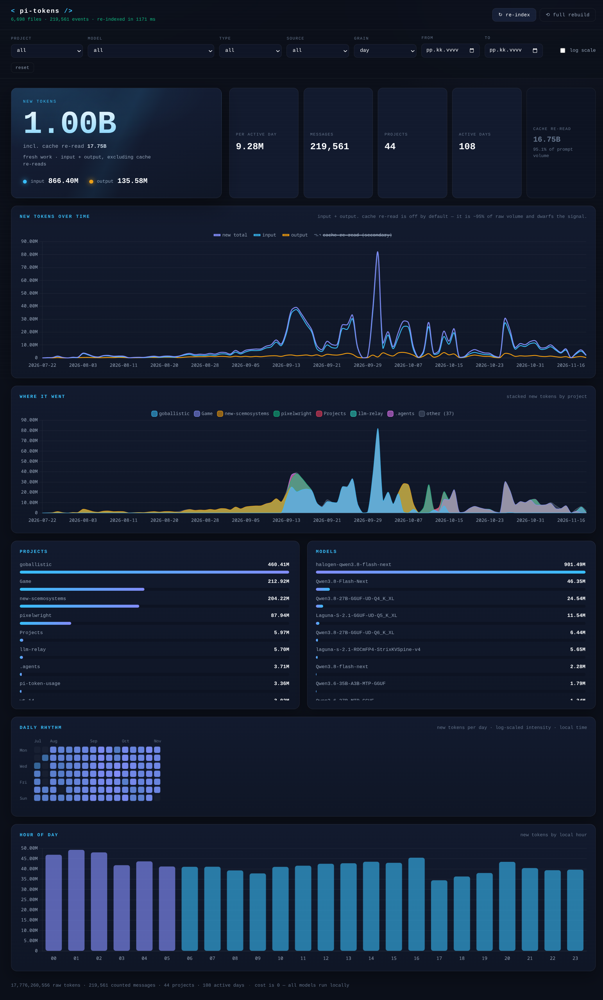

# pi-token-usage

Local dashboard for token usage by the [pi](https://pi.dev) coding agent — plus
[opencode](https://opencode.ai), [hermes-agent](https://hermes-agent.nousresearch.com) and
[ocr](https://github.com/alibaba/open-code-review), whose tokens are indexed
alongside pi's and can be filtered per source. Parses `~/.pi/agent/sessions`,
opencode's SQLite db, hermes-agent's state db and ocr's session transcripts into
one index and charts it per day / month / project / model / source.

Single static Go binary, Chart.js UI, no external services. All data stays on your
machine and the server binds to loopback only.



## Quick start

```bash
make build
make index          # parse sessions into ~/.local/share/pi-token-usage/index.db
make run            # http://127.0.0.1:7777
```

Or run it as a persistent container that comes back on every boot — see
[Docker](#docker):

```bash
make docker-up
```

Or without the browser:

```bash
make report BY=project
make report BY=month
make report BY=source   # pi vs opencode vs hermes vs ocr
```

## opencode tokens

opencode keeps per-message token accounting in
`~/.local/share/opencode/opencode.db` (SQLite, WAL). The indexer reads assistant
messages from it read-only and folds them into the same `usage_events` table with
`source='opencode'` — the UI's **source** filter then shows pi only, opencode
only, or both. Ingestion is incremental by `message.rowid` (opencode only
appends), so re-runs cost milliseconds.

opencode v2 moved storage from `session`/`message` to `session_v2`/`session_message`
and migrated the v1 history into the new tables. The indexer detects which
generation the db uses and reads only that pair — reading both would double-count
the migrated overlap — and a generation switch under an existing index triggers a
full re-ingest of the source so every message is counted exactly once. Both
generations ingest as the same `opencode` source.

- Override the path with `OPENCODE_DB=/path/to/opencode.db` or `-opencode PATH`
  on `index`/`serve`; `OPENCODE_DB=off` disables it.
- A missing or locked opencode db is skipped with a log line — it never breaks
  the pi index.
- opencode sessions map onto the existing dimensions: `directory` → project,
  `parent_id` → subagent kind, `modelID`/`providerID` → model/provider.

## ocr (open-code-review) tokens

ocr writes each review session as a JSONL transcript under
`~/.opencodereview/sessions/<flattened-repo>/<uuid>.jsonl`. The `llm_response`
records carry per-call usage (`prompt_tokens`/`completion_tokens`/
`cache_read_tokens`/`cache_write_tokens`) and are indexed as `source='ocr'`
through the same append-only offset machinery as pi's own logs — the other
record types (`llm_request` payloads, `tool_call`, errors) are skipped.
The provider name is read from the `provider` key of
`~/.opencodereview/config.json` (the API keys in that file are never read).

- Override with `OCR_SESSIONS_DIR=/path` or `-ocr PATH` on `index`/`serve`;
  `OCR_SESSIONS_DIR=off` disables it.
- A missing ocr directory is skipped silently — no ocr, no noise.

## hermes-agent tokens

hermes-agent keeps token accounting in `~/.hermes/state.db` (SQLite, WAL) as
**cumulative** counters: `session_model_usage` holds one row per
(session, model, billing, task) whose totals grow in place while the session
lives. There is no append-only log to tail, so ingestion is delta-based: the last
ingested per-field totals are kept in a `cum_state` table, and each run inserts
the growth as one `source='hermes'` event stamped at the row's `last_seen`.
Counters that shrink (session rewind) reset the baseline without emitting
negative events.

- Override the path with `HERMES_DB=/path/to/state.db` or `-hermes PATH` on
  `index`/`serve`; `HERMES_DB=off` disables it.
- A missing or locked hermes db is skipped with a log line — it never breaks
  the pi index.
- hermes sessions map onto the existing dimensions: `cwd` → project,
  `parent_session_id` → subagent kind, `model`/`billing_provider` → model/provider.

## Docker

The stack is defined in `docker-compose.yml` and runs as a persistent daemon:

```bash
make docker-up      # build + start → http://127.0.0.1:7777
make docker-logs    # follow logs
make docker-down    # stop
```

**It starts on boot.** The service has `restart: unless-stopped` and the docker
daemon is `enabled`, so the dashboard is back up after every reboot without a
systemd unit — and stays down only if you explicitly `make docker-down` it.
`make docker-ps` prints the live restart policy plus the daemon's boot state if
you ever need to prove that.

The image is a 16 MB `scratch` container. The compose file mounts everything
unconditionally and runs the container **as your host uid** (`RUNAS`), so
owner-only source dirs like `~/.opencodereview/sessions` (0700) are readable
without any ACL changes:

| Host | Container | Mode |
|---|---|---|
| `~/.pi/agent/sessions` | `/sessions` | read-only |
| `~/.local/share/opencode` | `/opencode` | read-only |
| `~/.opencodereview` | `/ocr` | read-only |
| `~/.hermes` | `/hermes` | read-only |
| `~/.local/share/pi-token-usage` | `/data` | read-write bind |

The mounts are unconditional because this runs on the host that owns the data —
a missing source is a no-op to the indexer, not a mount error. The container is
also `read_only: true` with a `/tmp` tmpfs.

The DB is a bind-mount of the host CLI's own directory, not a named volume —
a named volume would carry the image's staged 65534 ownership and be
unwritable by the host uid. Sharing one database means `make index` on the
host and the container see the same data (cross-path re-indexes are deduped
by message id, not double-counted).

### Config

`.env` holds the local values (paths, `TZ`, uid, port). The Makefile exports
its own variables, which take precedence over `.env`, so both entry points work:

```bash
make docker-up SESSIONS=/other/sessions PORT=8080 TZ=Europe/Berlin DATA_DIR=/other/dbdir RUNAS=1000:1000
docker compose up -d          # uses .env, no make involved
```

`TZ` is not cosmetic — `scratch` has no zoneinfo, so a wrong or missing `TZ`
shifts every daily bucket by hours. `PORT_BIND` defaults to `127.0.0.1`; set it
to `0.0.0.0` to expose the dashboard beyond loopback.

Other targets: `docker-build`, `docker-restart`, `docker-ps`, `docker-reindex`,
`docker-rebuild-index`, `docker-status`, `docker-shell CMD="report -by model"`,
and `docker-clean` (tears down the stack; the bind-mounted database is kept).

## How it works

```
~/.pi/agent/sessions/**/*.jsonl
        │  walk, classify, skip mirrors
        ▼
   parser        exact byte-offset resume, dedupe fork copies
        ▼
   SQLite      usage_events  ──GROUP BY──▶  facts (rollup)
        ▼
   HTTP API    /api/bootstrap  (whole cube, ~50 KB gzipped)
        ▼
   browser     every filter is client-side; no request per filter change
```

### Incremental by design

A full staleness check over a large session tree costs **milliseconds**, so the index refreshes
on page load rather than running a background watcher. The trigger is **file size,
not mtime** — rsync, restores and `touch` churn mtimes without adding content, and
keying on mtime would force pointless re-parses of hundreds of megabytes.

| Condition | Action |
|---|---|
| size unchanged | skip |
| size grew | tail-parse from the stored offset |
| size shrank | rewritten/compacted → full re-parse of that file |

A cold index of a multi-hundred-megabyte corpus takes seconds. Incremental re-runs take milliseconds.

## CLI

```
pitokens index [--full]     parse sessions into the database
pitokens serve              serve UI + API (cold-indexes first)
pitokens report -by X       text tables: day|month|project|model|provider|kind
pitokens healthcheck        exit 0 if the listener answers
```

Environment:

| Variable | Default | Purpose |
|---|---|---|
| `PI_SESSIONS_DIR` | `~/.pi/agent/sessions` | sessions root |
| `PITOKENS_DB` | `~/.local/share/pi-token-usage/index.db` | database path |
| `PITOKENS_ADDR` | `127.0.0.1:7777` | listen address |
| `OPENCODE_DB` | `~/.local/share/opencode/opencode.db` | opencode db (`off` disables) |
| `OCR_SESSIONS_DIR` | `~/.opencodereview/sessions` | ocr sessions (`off` disables) |
| `HERMES_DB` | `~/.hermes/state.db` | hermes-agent state db (`off` disables) |
| `TZ` | system local zone | day/hour bucketing |

## API

| Endpoint | Purpose |
|---|---|
| `GET /api/bootstrap` | cube + sessions + facets + totals in one call |
| `GET /api/totals` | headline numbers |
| `GET /api/cube` | raw rollup |
| `GET /api/sessions?limit=N` | session drill-down |
| `GET /api/status` | index freshness and table sizes |
| `POST /api/index?full=true` | trigger a re-index |

Responses are gzipped when requested.

## Development

```bash
make test    # unit tests (clean under -race)
make vet
```

The test suite deliberately covers known failure modes rather than the happy
path — offset drift, torn writes, self-dedupe, rollup idempotency, and late-night
day bucketing.

## Notes on cost

`cost` is zero throughout the session data because the models run locally. The
dashboard therefore reports tokens, not money.
